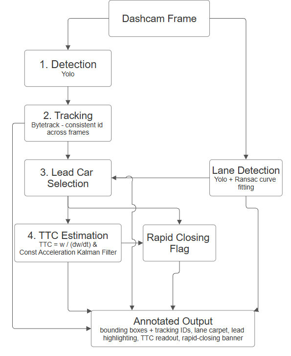
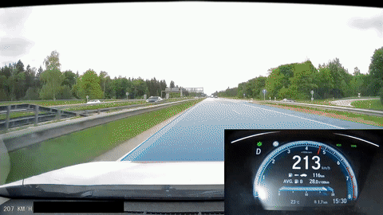
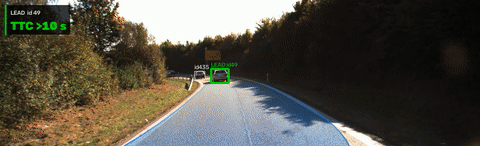

# Driving Risk Analyzer

A computer vision pipeline that watches dashcam footage, finds the vehicle you're following, estimates how long until you'd hit
it (time-to-collision), and flags sustained rapid-closing events. Done using box geometry, no camera calibration required.





## Demo






Both show detection boxes, tracking IDs, the lane carpet, the lead-vehicle highlight, the TTC readout, and a red rapid closing banner. 


## Tech stack

- **Detection:** YOLO (`yolo26n.pt`, Ultralytics), vehicle classes only
- **Tracking:** ByteTrack (built into Ultralytics)
- **Lane detection:** YOLOP (ONNX export, CPU inference via `onnxruntime`) + RANSAC curve fitting
- **TTC filtering:** hand-rolled Kalman filters (NumPy) — constant-velocity and constant-acceleration models
- **Core libraries:** OpenCV, NumPy, pandas, SciPy, Matplotlib  


## How it works

1. Detection | YOLO 
2. Tracking | ByteTrack — consistent IDs across frames | Lane detection | Pretrained YOLOP lane-line segmentation (ONNX, CPU) → RANSAC curve fit for the ego lane
3. Lead selection | The tracked vehicle directly ahead: gated by the detected ego lane 
4. TTC estimation | `TTC ≈ width / (d width / dt)` — Time-to-contact smoothed with a constant-acceleration Kalman filter
5. Rapid-closing flag | TTC sustained below a threshold for a minimum duration

Why box-width TTC instead of distance-based TTC: It works on any camera with no intrinsics or specific camera orientation or setup. 


## TTC filter: constant-acceleration model

The original filter I used assumed the box grows at a constant rate. A car closed in on at constant speed has width proportional to 1/distance, so its growth keeps accelerating as TTC drops — a constant-rate model always lags behind, overstating TTC.

Tested in `scripts/kitti_kalman_models.py` against KITTI 3D ground truth, on cars roughly straight ahead (:

| | TTC error (gt < 3s) | TTC error (gt < 6s) |
| constant-velocity on width (old) | 0.35s (bias +0.29s) | 0.52s (bias +0.35s) |
| constant-acceleration on width   | 0.21s (bias −0.08s) | 0.39s (bias −0.14s) |

Switching to the constant-acceleration model cut error by roughly a quarter to a third.

## Known limitations

1. Box-width TTC breaks down when the box is clipped by the edge of the frame - at the closest range, since a clipped box can shrink even as the real car keeps closing. Mitigated by detecting edge-truncation and freezing the filter's measurement update on those frames. The lost information is an inherent blind spot of box-width TTC at the closest ranges.
2. Occlusion breaks tracker ID continuity, which can resets the TTC filter's running estimate.
3. Lane gating only works where there are lane markings. On an unmarked street, lane gating fails.


## Reproducing

`uv sync` installs the pinned CPU-only dependency set (`uv.lock` is committed and checked clean). The pipeline runs on any dashcam-style video via `live.py`'s file mode; reproducing the exact demo outputs above additionally needs the source footage, which isn't in the repo (too large, and KITTI is redistributed under its own license) — download KITTI tracking sequence 0020 separately, or supply your own clip.

Lane detection needs YOLOP's ONNX weights in `cache/yolop/` (from the YOLOP repo's `weights/yolop-640-640.onnx`). Then, for any clip:

```
uv run python lane_yolop.py data/raw/your_clip.mp4 --no-video      # cache lane masks
uv run python ego_lane.py your_clip --horizon 0.47 --bottom 0.75
uv run python live.py --source data/raw/your_clip.mp4 \
    --egolane outputs/your_clip_egolane.csv --out outputs/your_clip_annotated.mp4
```

For KITTI: `ego_lane.py kitti_0020 --horizon 0.48`, then `kitti_headway_events.py 0020 --egolane ...` and `kitti_annotate.py 0020 --egolane ...`.

